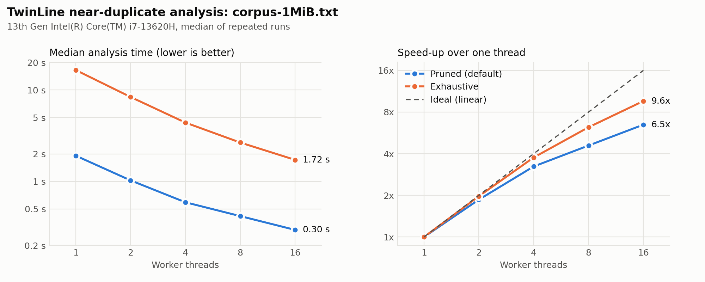

<div align="center">

# TwinLine

**A concurrent terminal editor that finds the lines that look alike.**

[](https://github.com/yusuffeness/TwinLine/actions/workflows/ci.yml)
[](https://codecov.io/gh/yusuffeness/TwinLine)


</div>

---

> [!NOTE]
> TwinLine is under active development. v0.9.0 makes it a tool for scripts
> and a safe place to work: `twinline analyze | clusters | dedupe | export`
> with JSON output and meaningful exit codes, a `config.toml`, autosave with
> crash recovery, and notices when another program changes an open file.
> Packaging and the 1.0 launch come next. Follow the
> [roadmap](docs/ROADMAP.md) to see what is next.

## What is TwinLine?

TwinLine is a line-based text editor for the terminal with a built-in
**near-duplicate detector**. It scans a document for lines that are identical
or almost identical, groups them and helps you clean them up, all while you
keep typing.

It started as a university assignment on POSIX threads and is being rebuilt
from the ground up as a polished, open-source tool.

## Quick start

```sh
make                       # build
make corpus                # generate a 1 MiB test corpus in corpus/
./build/twinline corpus/corpus-1MiB.txt
```

In a terminal, TwinLine opens its interactive UI:

```text
╭─────────────────────────────────────────────────────────────────╮
│  ████████╗██╗    ██╗██╗███╗   ██╗██╗     ██╗███╗   ██╗███████╗  │
│  ╚══██╔══╝██║    ██║██║████╗  ██║██║     ██║████╗  ██║██╔════╝  │
│     ██║   ██║ █╗ ██║██║██╔██╗ ██║██║     ██║██╔██╗ ██║█████╗    │
│     ██║   ██║███╗██║██║██║╚██╗██║██║     ██║██║╚██╗██║██╔══╝    │
│     ██║   ╚███╔███╔╝██║██║ ╚████║███████╗██║██║ ╚████║███████╗  │
│     ╚═╝    ╚══╝╚══╝ ╚═╝╚═╝  ╚═══╝╚══════╝╚═╝╚═╝  ╚═══╝╚══════╝  │
│ ✻ Welcome to TwinLine v0.6.0                                    │
│   /help for commands · ? for shortcuts · Tab to complete        │
╰─────────────────────────────────────────────────────────────────╯

> /threads
  ⎿ ✔ Thread panel on: each thread's progress is shown during analysis.
> /analyze
  ⎿ ✔ Analyzing 4662 lines in the background. Use 'status' or 'cancel'.
 ✺ Analyzing… 0.4 s · 44% · 4.8M / 11M pairs · 2 threads · esc to cancel
   █████████████████████▍░░░░░░░░░░░░░░░░░░░░░░░░░░  44%
     T1  █████████████████▍░░░░░░░░░░░░░░░░░░░░  46%
     T2  ████████████████▍░░░░░░░░░░░░░░░░░░░░░  43%
╭────────────────────────────────────────────────────────────────────╮
│ > Type a command, or / for the menu                                │
╰────────────────────────────────────────────────────────────────────╯
 ▸ med.txt · 4,662 lines · 2 threads · exhaustive
```

When the analysis is done, its result card counts up into place and a toast
confirms it:

```text
✔ Analysis finished in 1.04 s with 2 threads
  ⎿ 4,662 lines · 10,864,791 line pairs · mean J 0.0242
    ● 36 identical pairs    ● 40 near duplicates (J ≥ 0.70)
    Most similar pair  J 0.86
      917  ...disk started carefully!
     1327  ...disk started task
```

Output scrolls like any terminal program; only the input box, the command
menu and the status bar at the bottom are redrawn in place. Results of a
background analysis appear above the input box without disturbing what you
are typing, and the words that differ in the most similar pair are
highlighted (removed in red, added in green).

A render thread draws at 30 frames per second while something moves and
redraws only the rows that changed. When nothing moves it sleeps, so an idle
TwinLine uses no CPU.

### Commands

Commands are typed with a leading `/` in the terminal UI (`/open notes.txt`);
the `/` is optional in the plain interface.

**Files and buffers**

| Command          | Description                                                  |
| ---------------- | ------------------------------------------------------------ |
| `open[!] FILE`   | Load a file (`open!` discards unsaved changes)               |
| `reload[!]`      | Load the file again after another program changed it         |
| `recover [discard]` | Restore (or delete) the changes autosaved before a crash  |
| `save [FILE]`    | Save atomically to `FILE` or to the current file             |
| `new [FILE]`     | Open a new buffer, empty or with `FILE`                      |
| `buffers`        | List the open buffers                                        |
| `switch N`       | Make buffer `N` the active one                               |
| `close[!]`       | Close the active buffer (`close!` discards its changes)      |

**Editing**

| Command          | Description                                                  |
| ---------------- | ------------------------------------------------------------ |
| `append TEXT`    | Add a line at the end                                        |
| `insert N TEXT`  | Insert a line so that it becomes line `N`                    |
| `delete N[-M]`   | Delete line `N`, or lines `N` to `M`                         |
| `replace N TEXT` | Replace line `N`                                             |
| `edit N`         | Put line `N` into the input box to change it (prints it in the plain interface) |
| `undo`, `redo`   | Step back and forward through the changes                    |

**Viewing**

| Command          | Description                                                  |
| ---------------- | ------------------------------------------------------------ |
| `show [N[-M]]`   | Print the next page of 40 lines, a page from line `N`, or lines `N`-`M`; `show!` prints everything |
| `goto N`         | Show line `N` with three lines around it; the next `show` starts there |
| `find TEXT`      | List the lines containing `TEXT`, ignoring case (matches are highlighted in the terminal UI) |

**Analysis and the rest**

| Command          | Description                                                  |
| ---------------- | ------------------------------------------------------------ |
| `analyze`        | Find near-duplicate lines in the background                  |
| `analyze-sync`   | Same, but wait for the result                                |
| `cancel`         | Stop the running analysis                                    |
| `status`         | File, unsaved changes and analysis progress                  |
| `threads`        | Toggle the per-thread progress panel                         |
| `clusters [N]`   | Group the similar lines into clusters, or show cluster `N` with each line's similarity |
| `dedupe [N [K]]` | Keep the first line of every cluster, or of cluster `N` (or its `K`-th line); one `undo` restores everything |
| `export FILE`    | Save the clusters as `.json`, `.csv` or a colourful `.html` report |
| `set [NAME VALUE]` | Show or change the settings: `threshold`, `threads`, `strategy`, `exhaustive`, `fold`, `ngram`, `autosave` (seconds or `off`), `watch` (`on`/`off`) |
| `help`           | List the commands                                            |
| `quit[!]`        | Exit; asks again when any buffer has unsaved changes         |

Undoing back to the last save clears the "modified" mark again, and each
buffer keeps its own history of up to 1,000 changes.

A typical clean-up session:

```text
> /clusters
  ⎿ 3 clusters with 7 lines (strategy jaccard, threshold 0.60):
      #1      3 lines  The quick brown fox jumps over the lazy dog
            lines 1, 3, 5
      ...
> /clusters 1
  ⎿ Cluster 1 of 3 (3 lines):
        1.      1  first   The quick brown fox jumps over the lazy dog
        2.      3  same    the quick brown fox jumps over the lazy dog!
        3.      5  J 0.68  The quick brown fox jumped over the lazy dog
> /dedupe 1 3
  ⎿ ✔ Removed 2 lines from 1 cluster. Type 'undo' to bring them back.
> /export report.html
  ⎿ ✔ Exported 3 clusters and 2 pairs to 'report.html'.
```

Command-line options:

| Option | Meaning |
| ------ | ------- |
| `--threads=N` | Worker threads for the analysis (default: one per processor) |
| `--exhaustive` | Compare every pair; slower, but also reports the mean similarity |
| `--fold=turkish` | Fold `I` to dotless `ı` as in Turkish (default folds it to `i`) |
| `--threshold=X` | Near-duplicate threshold, above 0 and at most 1 (default 0.70) |
| `--strategy=NAME` | `jaccard` (exact, default), `exact` (identical lines only) or `minhash` (fast for large files); also `--exact`, `--minhash` |
| `--ngram=N` | Longest word n-gram compared, 1 to 4 (default 2: words and word pairs) |
| `--theme=NAME` | Colour theme: `dark` (default), `light`, `dracula`, `nord` |
| `--no-color` | No colours (the `NO_COLOR` environment variable works too) |
| `--no-animation` | No animations: still frames, progress updated 4 times a second (`TWINLINE_REDUCE_MOTION=1` works too) |
| `--plain` | The plain line interface, as used when input is piped |
| `--config=FILE`, `--no-config` | Read another configuration file, or none |

### Keyboard

| Key | Action |
| --- | ------ |
| `/` | Open the command menu; keep typing to filter it (fuzzy) |
| `Tab` | Complete the selected command, or a file name after `/open` and `/save` |
| `↑` `↓` | Move in the menu, or browse the command history |
| `Ctrl+R` | Search the history |
| `Esc` | Close the menu, or cancel a running analysis |
| `Ctrl+A` `Ctrl+E` | Start / end of the line |
| `Ctrl+←` `Ctrl+→` | Previous / next word |
| `Ctrl+U` `Ctrl+K` `Ctrl+W` | Delete to the start, to the end, the previous word |
| `Ctrl+L` | Clear the screen |
| `?` | Show the shortcuts |
| `Ctrl+C` twice | Exit |

The UI uses 24-bit colour when the terminal announces it (`COLORTERM`), the
256-colour palette otherwise, and no colour with `NO_COLOR` or `--no-color`.
When input or output is not a terminal (pipes, scripts, CI), TwinLine falls
back to the plain interface automatically.

### How the analysis works

Each line becomes a set of word and word-pair (bigram) hashes. Words are
split on Unicode-aware boundaries and case-folded, so `ÇAY` matches `çay` and
curly quotes or dashes do not count as letters. Two lines are compared with
the Jaccard similarity `|A ∩ B| / |A ∪ B|`; pairs at or above the threshold
(0.70 by default) are near duplicates.

There are three strategies:

| Strategy | Finds | Cost | Use it for |
| -------- | ----- | ---- | ---------- |
| `jaccard` (default) | every near-duplicate pair, exactly | all pairs, with exact pruning | files up to a few MiB |
| `minhash` | near duplicates; every pair it reports is real, a few may be missed | about linear | large files |
| `exact` | identical lines only | linear | a quick duplicate check |

All of them run on every processor core and on a snapshot of the document,
so you can keep editing. Clusters join lines that are similar directly or
through other lines (union-find). Details:
[docs/ALGORITHMS.md](docs/ALGORITHMS.md).

## Scripting

Every analysis also runs without the editor, for scripts, pipelines and CI:

```sh
twinline analyze notes.txt                  # report; exit 1 if anything is similar
twinline analyze --json --minhash big.txt   # the same as JSON, for large files
twinline clusters --threshold=0.6 notes.txt # every cluster with its lines
twinline dedupe notes.txt -o clean.txt      # keep one line per cluster
twinline dedupe --in-place notes.txt        # ... or rewrite the file (atomically)
cat log.txt | twinline dedupe - > unique.txt
twinline export notes.txt report.html       # .json, .csv or .html
twinline config                             # the settings in effect, as TOML
```

`-` reads standard input. Each subcommand takes the analysis options above
and has its own `--help`.

| Exit code | Meaning |
| --------- | ------- |
| 0 | Success; `analyze` and `clusters` found nothing similar |
| 1 | `analyze` and `clusters` found identical or near-duplicate lines |
| 2 | Bad command line or configuration file |
| 3 | A file could not be read or written |
| 4 | Anything else (out of memory) |

So `twinline analyze docs/*.txt || echo "duplicates found"` works as a check,
and `--json` output is stable for other programs to read.

## Configuration

Settings live in `~/.config/twinline/config.toml` (or under
`$XDG_CONFIG_HOME`, or wherever `TWINLINE_CONFIG` points). Command-line
options win over the file, the file over the defaults:

```toml
[analysis]
threshold = 0.75
strategy  = "jaccard"   # jaccard, exact or minhash
ngram     = 2

[ui]
theme      = "nord"
animations = true

[autosave]
interval = 30           # seconds

[watch]
enabled = true
```

`twinline config > ~/.config/twinline/config.toml` writes a complete file to
start from. A mistake is reported with its line (`config.toml:3: unknown key
'treshold' in [analysis]`) instead of being ignored. Every key is described
in [docs/CONFIGURATION.md](docs/CONFIGURATION.md).

## Safety

- **Autosave and crash recovery.** Every 30 seconds, unsaved changes are
  written to a recovery file next to the original (`.notes.txt.twinline.swp`,
  readable only by you). Saving or quitting normally removes it. If TwinLine
  is killed or the machine stops, the next `open` says so; `recover` loads
  the changes as one edit (`undo` returns to the file on disk) and
  `recover discard` deletes them.
- **Watching files.** When another program changes or deletes an open file,
  TwinLine says so once; `reload` loads the new version (as one edit, so
  `undo` brings yours back). Its own saves never trigger the notice. On Linux
  the folders are watched with inotify, so the notice is immediate; other
  systems check once a second.
- **Atomic saves.** Files are written to a temporary file and renamed, so a
  crash never leaves half a file.

## Performance



On a 1 MiB corpus (16,357 lines, 134 million line pairs) on an Intel Core
i7-13620H:

| Mode | 1 thread | 16 threads | Speed-up |
| ---- | -------- | ---------- | -------- |
| Exhaustive (the original algorithm) | 16.5 s | 1.72 s | 9.6x |
| Pruned (default) | 1.91 s | **0.30 s** | 6.5x |

From the original single-threaded algorithm to the default mode on all
cores, the same analysis runs **56 times faster** with identical results.
Reproduce the chart on your machine with `make bench`.

With `--minhash`, the same 1 MiB corpus is analysed in **0.03 s** with the
same counts and the same most similar pair, and a 100 MiB file (1.6 million
lines) in about 7 s on a 2-core virtual machine. MinHash recall against the
exact search on the 1 MiB corpus, measured with `make bench-accuracy`:

| Threshold | True pairs | Found by MinHash | Recall | Precision |
| --------- | ---------- | ---------------- | ------ | --------- |
| 0.5 | 289 | 287 | 99.3% | 100% |
| 0.7 | 126 | 126 | 100% | 100% |

Files of 8 MiB and more open in **large-file mode**: the file is mapped into
memory and split into lines in place, so no line is copied or allocated on
its own. On a 100 MiB file (1.6 million lines) loading takes 0.063 s instead
of 0.105 s (1.7x); `bench_load FILE` measures it on your machine.

## Planned features

- **Side-by-side view** of all near-duplicate pairs.
- Packages for Homebrew and Debian, a container image, a man page and a demo.

## Building from source

Requirements: a C17 compiler (GCC or Clang), CMake 3.16+ and a POSIX system
(Linux, macOS, or WSL on Windows).

```sh
git clone https://github.com/yusuffeness/TwinLine.git
cd TwinLine
make            # or: cmake -S . -B build && cmake --build build
./build/twinline --help
```

Useful targets:

| Command        | What it does                                      |
| -------------- | ------------------------------------------------- |
| `make`         | Release build in `build/`                         |
| `make test`    | Build and run every test                          |
| `make debug`   | Debug build in `build-debug/`                     |
| `make asan`    | Run the tests with AddressSanitizer and UBSan     |
| `make tsan`    | Run the tests with ThreadSanitizer                |
| `make coverage`| Coverage report with gcovr                        |
| `make bench`   | Benchmark and redraw `docs/assets/benchmark.png`  |
| `make corpus`  | Generate a test corpus (`CORPUS_SIZE=10MiB`)      |
| `make format`  | Format the sources with clang-format              |
| `make help`    | List every target                                 |

## Testing

Every change is checked by unit tests, golden-file integration tests and
fuzz targets, and by GitHub Actions on Linux and macOS with GCC and Clang,
AddressSanitizer, UndefinedBehaviorSanitizer, ThreadSanitizer, Valgrind,
clang-tidy and coverage reporting. See [docs/TESTING.md](docs/TESTING.md).

## Project layout

```
include/twinline/   Public headers
src/                Sources: core, analysis, cmd (commands), tui (terminal UI)
tests/              Unit, integration and fuzz tests
bench/              Benchmarks
scripts/            Helper scripts (test corpus generator, demo recording)
docs/               Roadmap, architecture notes and design decisions
```

## Roadmap

TwinLine is built in ten milestones, from the project skeleton (v0.1.0) to a
packaged v1.0.0 release. See [docs/ROADMAP.md](docs/ROADMAP.md).

## License

TwinLine is released under the [MIT License](LICENSE).
