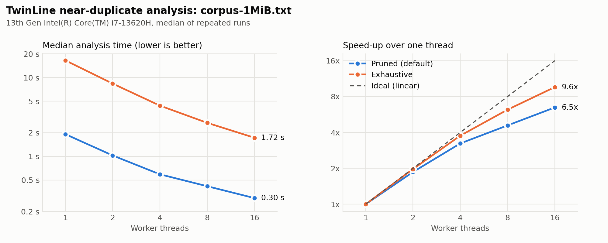

# Algorithms

This document explains how TwinLine finds near-duplicate lines, and why the
optimisations it uses never change the answer.

## 1. From a line to a feature set

Each line is split into words on Unicode-aware boundaries: letters, digits and
combining marks belong to words; punctuation, symbols, spaces and emoji
separate them. Words are case-folded (`ÇAY` → `çay`; with `--fold=turkish`,
`I` → `ı`).

The **feature set** of a line contains every word and every pair of adjacent
words (bigram). Bigrams make word order count: "a b" and "b a" share their
words but not their bigram.

```
"The server answered quickly."
words:   the, server, answered, quickly
bigrams: the+server, server+answered, answered+quickly
```

Every feature is stored as a 64-bit hash (FNV-1a for words, a SplitMix64 mix of
two word hashes for bigrams). The hashes of a line are sorted and deduplicated,
so a feature set is a sorted array of unique 64-bit integers.

## 2. Similarity

Two lines are compared with the **Jaccard similarity** of their feature sets:

```latex
J(A, B) = \frac{|A \cap B|}{|A \cup B|} = \frac{c}{|A| + |B| - c}, \quad c = |A \cap B|
```

`J = 1` means identical feature sets (the lines differ at most in case,
punctuation or spacing); pairs with `J >= 0.70` are reported as near
duplicates. Because both arrays are sorted, `c` is computed with a linear
merge in `O(|A| + |B|)`.

## 3. The naive algorithm

For `n` lines there are `n(n - 1) / 2` pairs. The 1 MiB test corpus has about
15,000 lines, i.e. about 105 million pairs; the original single-threaded
version needed about 11 seconds for it.

## 4. Two exact filters

A pair only matters if it is a near duplicate (`J >= t`, the threshold) or if
it beats the best similarity found so far (`J > best`). Let
`τ = min(t, best)`. Any pair that provably has `J < τ` can be skipped
without changing any reported number.

### Size bound

Since `c <= min(|A|, |B|)` and `|A ∪ B| >= max(|A|, |B|)`:

```latex
J(A, B) \le \frac{\min(|A|, |B|)}{\max(|A|, |B|)}
```

The entries are sorted by set size. For a fixed row `A`, the candidates `B`
that follow it only get larger, so the bound only decreases. As soon as it
drops below `τ`, the rest of the row is skipped in one step.

### Early exit from the intersection

`J` grows with `c`, so `J >= τ` needs at least `c_min` common features, where
`c_min` is the smallest integer with `c_min / (|A| + |B| - c_min) >= τ`.
During the merge, if the features found so far plus the elements still left
in the shorter array cannot reach `c_min`, the pair is abandoned.

`c_min` is computed with the same floating-point expression that scores the
pair, so the filter and the score can never disagree because of rounding.
Most pairs share almost nothing and are dropped after a few steps.

### Why the result is exact

- **Identical pairs** have `J = 1 >= τ` and are never filtered.
- **Near duplicates** have `J >= t >= τ` and are never filtered.
- **The most similar pair** has `J >= best >= τ` and is never filtered; a
  filtered pair has `J < best` and cannot tie with it either.

The only quantity that needs every pair is the mean similarity, so it is
reported only in exhaustive mode (`--exhaustive`), which disables both filters.

## 5. Parallel comparison

1. **Index.** All feature sets are written into one contiguous arena (one
   allocation instead of one per line) and the entries are sorted by size.
2. **Compare.** Worker threads repeatedly take the next chunk of rows from a
   shared atomic cursor (`atomic_fetch_add`). Early rows have more work, and
   dynamic hand-out keeps every thread busy until the end. Each worker keeps
   its own counters and best pair, so the inner loop takes no locks; the
   only shared writes are the cursor and a relaxed progress counter.
3. **Merge.** Per-worker results are added up. The best pair is chosen by
   highest similarity, then lowest line numbers, which is exactly the pair a
   sequential scan finds first. Results are therefore identical for any
   number of threads.

Each worker's `best` (and with it `τ`) is local, so how much work is skipped
depends on scheduling, but what is reported does not.

## 6. Verification

- `tests/unit/test_parallel.c` compares the engine with an independent,
  plain all-pairs implementation for 1 to 16 threads, several thresholds and
  both modes, down to the line numbers of the best pair.
- The sanitizer jobs in CI run the same tests under ThreadSanitizer.

## 7. Results

Measured with `make bench` on a 1 MiB generated corpus (16,357 lines,
133.8 million pairs) on an Intel Core i7-13620H (6 performance and 4
efficiency cores, 16 hardware threads), median of three runs:

| Threads | Exhaustive | Speed-up | Pruned (default) | Speed-up |
| ------: | ---------: | -------: | ---------------: | -------: |
| 1 | 16.53 s | 1.0x | 1.91 s | 1.0x |
| 2 | 8.39 s | 2.0x | 1.03 s | 1.9x |
| 4 | 4.40 s | 3.8x | 0.59 s | 3.2x |
| 8 | 2.66 s | 6.2x | 0.42 s | 4.6x |
| 16 | 1.72 s | 9.6x | 0.30 s | 6.5x |



Reading the numbers:

- **Filters versus brute force:** on one thread the filters alone make the
  analysis 8.6 times faster; together with 16 threads it is 56 times faster
  than the exhaustive single-threaded scan, with identical results.
- **Scaling beyond 8 threads is sub-linear** because the processor has only
  6 performance cores; the remaining threads run on efficiency cores and
  hyper-threads that share execution units.
- **The pruned mode scales a little less** than the exhaustive mode: each
  worker starts with `best = 0` and needs a few rows before its filter
  becomes sharp, so with more threads slightly more pairs are scored (87.5
  million on one thread, 100.7 million on 16). The work per pair is also so
  small that memory bandwidth starts to matter.

On the 1 MiB corpus of the original course project (14,497 lines), on a
2-core virtual machine, the original program took 11.1 s and the default mode
0.72 s, with the same 67 identical pairs, 100 near duplicates and most similar
pair.

## 8. Editing, undo and large files

Every change to a document is a **splice**: `remove` lines starting at an
index are replaced by `count` new lines. Append, insert, delete and replace
are all splices, so the undo history only needs to know one operation. Each
recorded edit keeps copies of the lines it removed and of the lines it put
in their place; undo splices the old lines back, redo splices the new ones
in again.

Every state of the history has an id. A buffer remembers the id of the state
it was last opened or saved in, and is "modified" exactly when the current
id differs, so undoing back to the save makes the buffer clean again. The
history keeps 1,000 edits; older ones are forgotten.

Files of 8 MiB and more are loaded in **large-file mode**. The file is mapped
with `mmap(MAP_PRIVATE)`, and each line terminator inside the mapping is
overwritten with a NUL, so the lines are used where they are, without a copy
or an allocation each. Writes go to private copy-on-write pages, never to the
file. A line that ends at the end of the file without a terminator has no
byte left for its NUL and is the only one copied. Lines added later are
ordinary allocations; the document tells the two apart by checking whether a
line's address falls inside the mapping.

Saving writes a new file and renames it over the old one, so the mapping
(which still refers to the old file) stays valid. As with any memory-mapped
file, another program truncating the file while it is open can make TwinLine
fail; editors usually accept that trade-off for large files.

## 9. Strategies for large files

The pairwise search of sections 3-5 is exact but quadratic: a file with ten
times the lines has a hundred times the pairs. Two other strategies trade
generality for speed. Both start the same way.

**Identical lines.** Each feature set is hashed, the lines are sorted by
(size, hash) and equal sets end up next to each other, where they are
compared byte for byte. Every group becomes one distinct text, represented
by its first line. `k` copies of a text contribute `k(k-1)/2` identical
pairs. The `exact` strategy stops here: it finds every identical pair in
`O(n log n)` and does not look for near duplicates.

**MinHash.** For a random hash function `h`, the smallest `h` over a set is
the same for two sets with probability `J(A, B)`. TwinLine computes 128
such minimums per distinct text (its signature) with multiply-add hash
functions over the mixed feature hashes.

**LSH bands.** The signature is cut into 32 bands of 4 values, and each band
is hashed into a 32-bit key. Two texts become candidates if any band key is
equal, which happens with probability

```
P(J) = 1 - (1 - J^4)^32
```

| J | 0.3 | 0.5 | 0.6 | 0.7 | 0.8 | 0.9 |
| - | --- | --- | --- | --- | --- | --- |
| P | 23% | 87% | 98.8% | 99.98% | > 99.999% | > 99.999% |

Each band is sorted with a radix sort, and texts with the same key are
paired. A pair that already met in an earlier band is skipped, so it is
scored once. Every candidate is then scored with the exact Jaccard
similarity and the same size bound as the pairwise search. A reported pair
is therefore always truly similar: errors can only be misses, and those are
rare above J = 0.6. `bench_accuracy` measures the recall against the exact
search: 100% at 0.7 and 99.3% at 0.5 on the 1 MiB corpus.

The cost is linear in the number of distinct texts for the signatures, plus
32 sorts and the candidates of each bucket. On the 1 MiB corpus it gives the
same counts and the same most similar pair as the exact search, 39 times
faster.

## 10. Clusters

Similarity is not transitive: A can be like B and B like C while A and C
differ. A cluster is a connected group: lines joined by a chain of similar
pairs, plus all copies of each text. TwinLine builds the clusters with
union-find over the distinct texts (path halving, the smaller index as the
root, so the result does not depend on the order of the pairs). Clusters are
listed largest first, then by their first line.

`dedupe` keeps one line per cluster and removes the others in a single edit
(section 8), so one `undo` brings them all back. The clusters belong to the
document state and settings they were computed with: after a change,
`dedupe` asks for `clusters` again rather than act on stale line numbers.
